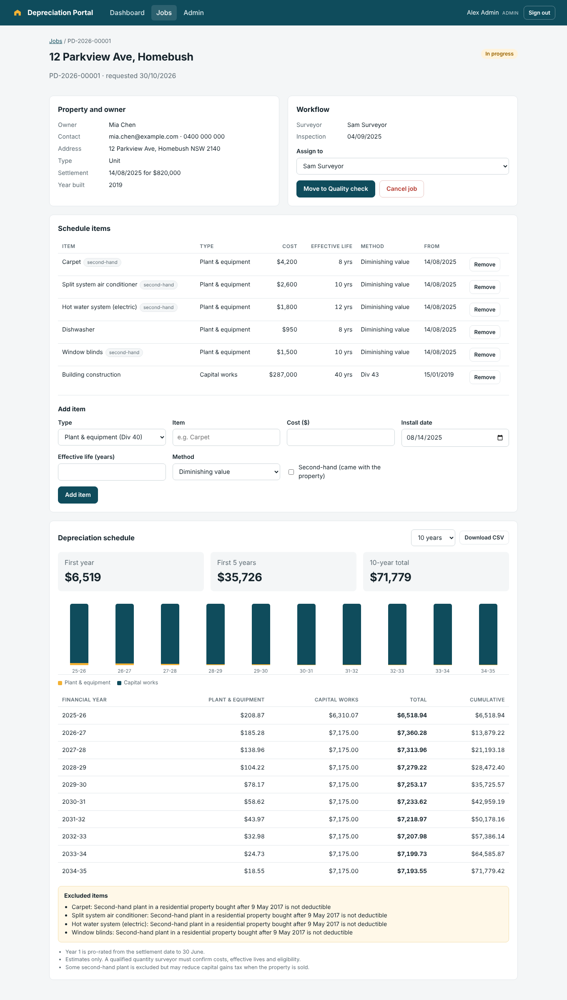
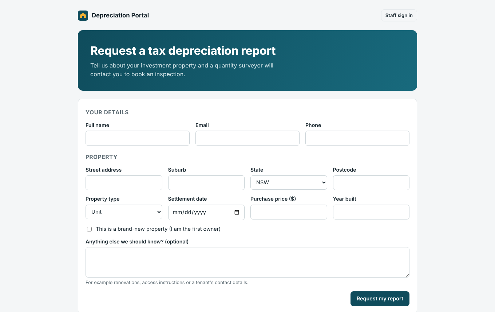
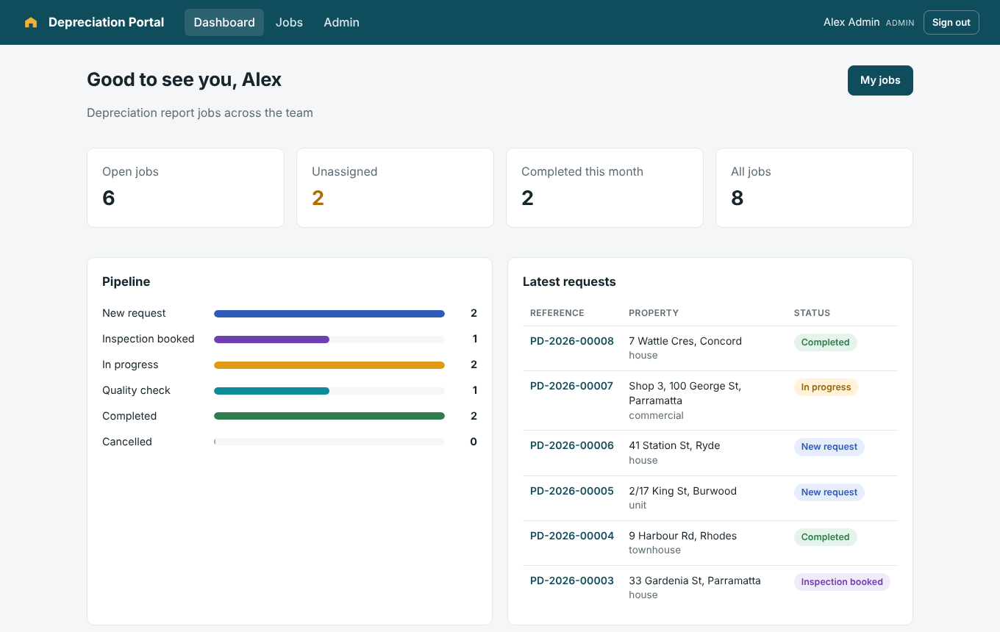
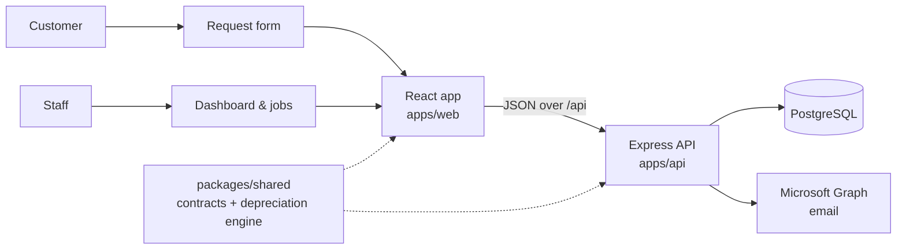

# Property Depreciation Portal

A full-stack TypeScript app for a quantity surveying business. Property investors request a tax depreciation report online, staff move each job through an inspection and quality workflow, and surveyors build a Division 40 and Division 43 depreciation schedule that can be downloaded as CSV.

Built with **React, Node.js (Express), PostgreSQL and TypeScript**, using **Claude Code** as the primary coding agent ([how I work with it](docs/claude-code-workflow.md)).



## Features

- **Customer request form.** A public form with field-level validation that creates a job with a reference number (for example `PD-2026-00009`) and notifies the team.
- **Staff dashboard.** Shows open, unassigned and completed jobs, the job pipeline by status, and the latest requests.
- **Job workflow.** Jobs move through New, Inspection booked, In progress, Quality check and Completed. The API only allows valid moves (a job can't jump from New to Completed).
- **Depreciation engine.**
  - Division 40 plant and equipment, using the diminishing value or prime cost method
  - Division 43 capital works at 2.5% or 4%, depending on when construction started
  - First year pro-rated to 30 June
  - Second-hand plant in residential property bought after 9 May 2017 is excluded
  - Capital works stop once the 40-year life has been used up
- **Schedules.** A 5, 10, 20 or 40-year schedule with a chart, yearly totals and CSV export.
- **Authentication and access control.**
  - Sessions use an httpOnly, SameSite cookie with a JWT. Passwords are hashed with bcrypt.
  - Admin, surveyor and viewer roles are enforced in the API.
  - Surveyors can only change jobs that are unassigned or assigned to them.
  - Login and the public form are rate limited, and security headers are set with Helmet.
- **Audit log.** Records every change: who did what, and when.
- **Microsoft 365 integration.** Optional email notifications through the Microsoft Graph API, using an app registration with client credentials.
- **Shared API contracts.** Zod schemas in `packages/shared` validate requests in the API and forms in the browser, so the two can't drift apart.

| Customer request form | Staff dashboard |
| --- | --- |
|  |  |

## Tech stack

| Area | Tools |
| --- | --- |
| Frontend | React 19, TypeScript, Vite, React Router |
| Backend | Node.js 22, Express 5, TypeScript, Zod |
| Database | PostgreSQL 16 with SQL migrations and parameterised queries |
| Auth & security | JWT in httpOnly cookies, bcrypt, role-based access control, rate limiting, Helmet |
| Integrations | Microsoft Graph API (Microsoft 365 email) |
| Testing | Vitest (engine and API against real PostgreSQL), Supertest, Playwright browser tests |
| DevOps | Docker, Docker Compose, GitHub Actions CI, Railway config |
| AI tooling | Claude Code with `CLAUDE.md` project rules and permission settings |

## Architecture



In production, a single container runs the API, which also serves the built React app, so it can be deployed as one service on Railway, Render, AWS App Runner or Google Cloud Run.

## Getting started

### Docker

```bash
docker compose up --build
docker compose exec app node apps/api/dist/cli/seed.js   # demo users and jobs
```

Then open http://localhost:4000.

### Local development

You need Node.js 22 and PostgreSQL.

```bash
npm ci
cp .env.example .env            # then set DATABASE_URL and JWT_SECRET
createdb depreciation
npm run db:seed                 # runs migrations and loads demo data
npm run dev                     # API on :4000, web app on :5173
```

**Demo logins** (password `demo-password-2026`):

| Email | Role |
| --- | --- |
| `admin@example.com` | Admin |
| `surveyor@example.com` | Surveyor |
| `viewer@example.com` | Viewer (read-only) |

## Testing

```bash
createdb depreciation_test && createdb depreciation_e2e
npm run lint && npm run typecheck
npm test                        # 13 engine tests + 17 API tests on PostgreSQL
npm run build && npm run test:e2e   # 3 Playwright browser tests
```

The API tests cover authentication, role permissions, job ownership, workflow rules, SQL injection attempts, rate limiting, the audit log and the Microsoft Graph integration. The browser tests follow a customer request through to a calculated schedule. GitHub Actions runs all of this on every pull request and builds the Docker image.

## Deployment (Railway)

1. Create a Railway project with a PostgreSQL database.
2. Add this repo as a service. `railway.json` builds the Dockerfile and checks `/api/health`.
3. Set `DATABASE_URL` (from the Railway Postgres service) and a random `JWT_SECRET` of at least 32 characters.
4. Migrations run automatically on start.

## API

| Method | Endpoint | Access |
| --- | --- | --- |
| POST | `/api/requests` | Public (rate limited) |
| POST | `/api/auth/login`, `/api/auth/logout` | Public |
| GET | `/api/auth/session` | Public |
| GET | `/api/dashboard`, `/api/jobs?status=&q=&mine=` | Signed in |
| GET | `/api/jobs/:id`, `/api/jobs/:id/schedule`, `/api/jobs/:id/schedule.csv` | Signed in |
| PATCH | `/api/jobs/:id` | Admin, or surveyor on own or unassigned job |
| POST / DELETE | `/api/jobs/:id/assets` | Admin, or surveyor on own or unassigned job |
| GET / POST | `/api/users`, `/api/audit` | Admin (the user list is readable by all staff) |

## Project structure

```
packages/shared/src/
  contracts.ts        # Zod schemas and types shared by API and web
  depreciation.ts     # Division 40 / 43 engine
apps/api/
  migrations/         # SQL migrations
  src/routes/         # public, auth, jobs, users
  src/auth.ts         # sessions, password hashing, role checks
  src/services/       # Microsoft Graph notifier
  test/               # API tests
apps/web/src/pages/   # request form, dashboard, jobs, job detail, admin
e2e/                  # Playwright tests
CLAUDE.md             # rules for coding agents
```

## Next steps

- Generate the full PDF depreciation report
- Sync completed jobs to Salesforce
- Take online payments for reports with Stripe
- Add low-value pool and immediate write-off rules to the engine

---

Built by [Pramisha K C](https://pramishakc3.github.io). A demo with fictional data, not affiliated with any real quantity surveying firm. Depreciation figures are estimates for demonstration and are not tax advice.
